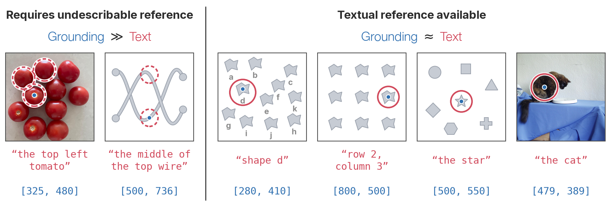

# Where and Why is Grounded Reasoning Useful?

[](https://arxiv.org/abs/2611.08485)
[](https://elorian.ai/blog/why-grounding)
[](https://huggingface.co/datasets/elorian-ai/why-grounding)
[](https://huggingface.co/datasets/elorian-ai/BrickVision)
[](LICENSE)

This repo contains the code for "Where and Why is Grounded Reasoning Useful?", along with utils for the BrickVision benchmark. 

<p align="center"></p>

## Installation

```bash
git clone https://github.com/elorian-ai/why-grounding.git && cd why-grounding
uv sync --all-extras                     # CPU: data, BrickVision, tables, figures
uv sync --project envs/gpu               # GPU: SFT, evaluation, decode-time randomization
docker build -t grounded-reasoning-rl envs/rl   # RL (verl)
```

Data, checkpoints and outputs go to `data/`, `runs/` and `results/` (or `$GR_DATA`, `$GR_RUNS`, `$GR_RESULTS`).
Run GPU commands inside `envs/gpu` (`source envs/gpu/.venv/bin/activate`). `envs/paper_versions.txt` lists the
exact package versions of the paper's runs (RL: `envs/rl/Dockerfile`).

## BrickVision

```bash
hf download elorian-ai/BrickVision --repo-type dataset --local-dir data/brickvision
python -m brickvision.evaluate score --predictions my_model.jsonl
```

Tasks, format and results: [`brickvision/README.md`](brickvision/README.md).

## Code

| | |
|---|---|
| `grounded_reasoning/data.py` | reasoning traces and the SFT arms (text, grounded, appended, grounded_box, grounded_rand*) |
| `grounded_reasoning/rl.py` | RL data, pass@k filtering, GRPO reward |
| `grounded_reasoning/benchmarks.py`, `evaluate.py` | the 11 benchmarks, prompts, answer parsing, lmms-eval runs, CIs |
| `grounded_reasoning/randomize.py` | decode-time coordinate randomization |
| `grounded_reasoning/probes/` | wire tracing, prompted counting, arrow following |
| `brickvision/` | generation, restyling, evaluation of BrickVision |
| `paper/` | tables and figures |
| `configs/sft.yaml`, `scripts/` | LLaMA-Factory config, training and evaluation launchers |

## Reproducing the paper

To reproduce our work from released model outputs/traces, run:

```bash
hf download elorian-ai/why-grounding --repo-type dataset --include "results/*" --local-dir .
hf download elorian-ai/BrickVision --repo-type dataset --local-dir data/brickvision
make tables
```

`make paper` also draws the figures. These need the downloads from the first four commands below, plus
[TreeVGR-SFT-35K](https://huggingface.co/datasets/HaochenWang/TreeVGR-SFT-35K) in `data/treevgr_sft/` for Figure 7.

To reproduce our work from scratch, run (expects an 8-GPU node):

```bash
bash scripts/download_benchmarks.sh                    # 11 benchmarks
hf download elorian-ai/why-grounding --repo-type dataset --include "data/*" --local-dir .   # SFT, RL, probe data
hf download elorian-ai/BrickVision --repo-type dataset --local-dir data/brickvision
python data/fetch_images.py tvg treevgr probes         # TVG and TreeVGR-RL-37K images, probe image shards

# Tables 2, 3, 6: SFT formats (appended, box) and text vs grounded reasoning after SFT and RL
for seed in 17 18 19; do
  for arm in text grounded grounded_box appended; do
    bash scripts/train_sft.sh $arm $seed
    bash scripts/evaluate.sh runs/sft/${arm}_s$seed sft/${arm}_s$seed
  done
  for arm in text grounded; do
    JUDGE_URL=... bash scripts/train_rl.sh $arm $seed  # in the RL image; JUDGE_URL from scripts/serve_judge.sh
    bash scripts/evaluate.sh runs/rl/${arm}_s$seed rl/${arm}_s$seed
  done
done

# Table 1 and Figure 3: decode-time and training-time coordinate randomization
for arm in grounded_rand05 grounded_rand20 grounded_rand50 grounded_rand100; do
  bash scripts/train_sft.sh $arm && bash scripts/evaluate.sh runs/sft/${arm}_s17 sft/${arm}_s17
done
bash scripts/decode_randomization.sh

# Figure 4: synthetic probe tasks
for task in wire_tracing prompted_counting arrow_following; do bash scripts/probes.sh $task; done

# Table 4: BrickVision
bash scripts/brickvision.sh sft-data
for arm in direct text grounded; do bash scripts/train_sft.sh brickvision_$arm; done
bash scripts/brickvision.sh eval && bash scripts/brickvision.sh api && bash scripts/brickvision.sh table

make paper
```

## Data and checkpoints

All data and checkpoints are on Hugging Face. Download each into the folder listed below (relative to the repository
root) and the scripts will find it.

| Hugging Face repo | Folder | Contents |
|---|---|---|
| [`elorian-ai/BrickVision`](https://huggingface.co/datasets/elorian-ai/BrickVision) | `data/brickvision/` | the BrickVision benchmark |
| [`elorian-ai/why-grounding`](https://huggingface.co/datasets/elorian-ai/why-grounding) | `data/` | SFT sets with their reasoning traces, RL data, probe tasks |
| | `runs/` | checkpoints: text and grounded SFT and RL models (seeds 17-19), BrickVision fine-tunes |
| | `results/` | model outputs behind every table and figure |

To download a single folder or checkpoint, use `--include`:

```bash
hf download elorian-ai/why-grounding --repo-type dataset --include "runs/sft/grounded_s17/*" --local-dir .
```

We do not re-host images from existing datasets. `scripts/download_benchmarks.sh` (benchmarks) and
`data/fetch_images.py` (TVG and TreeVGR, included in `data/`) download them from their sources at pinned revisions.

## Citation

```bibtex
@article{yan2026grounded,
  title   = {Where and Why is Grounded Reasoning Useful?},
  author  = {Yan, David and Xue, Le and Huang, Forrest and Zhang, Qiuyi and Tran, Dustin and Dai, Andrew M. and Yang, Yinfei},
  journal = {arXiv preprint arXiv:2611.08485},
  year    = {2026}
}
```

Code: [Apache-2.0](LICENSE). BrickVision and probe data: CC BY 4.0; other datasets keep their upstream licences.
Built on [LLaMA-Factory](https://github.com/hiyouga/LLaMA-Factory), [verl](https://github.com/volcengine/verl),
[lmms-eval](https://github.com/EvolvingLMMs-Lab/lmms-eval), [vLLM](https://github.com/vllm-project/vllm),
[Thinking with Visual Grounding](https://github.com/Jun-Kai-Zhang/visually_grounded_thinking) and
[TreeVGR](https://github.com/Haochen-Wang409/TreeVGR).
